<table>
  <tr>
    <td valign="top"></td>
    <td valign="top"></td>
  </tr>
</table>

<a href="https://sorenverse.vercel.app"><code>SORENVERSE</code></a>
&nbsp;/&nbsp;
<a href="https://www.instagram.com/soren.verse_insights"><code>INSTAGRAM</code></a>
&nbsp;/&nbsp;
<a href="mailto:hello@sorenverse.in"><code>EMAIL</code></a>

BIDYA SAGAR SOREN — VISUAL DESIGNER &amp; VIDEO EDITOR

