<a href="https://github.com/bidyasagar29?tab=repositories"><code>VIEW ALL REPOSITORIES &rarr;</code></a>

<a href="https://sorenverse.vercel.app"><code>PORTFOLIO</code></a>
&nbsp;/&nbsp;
<a href="https://www.instagram.com/soren.verse_insights/"><code>INSTAGRAM</code></a>
&nbsp;/&nbsp;
<a href="mailto:hello@sorenverse.in"><code>EMAIL</code></a>
&nbsp;/&nbsp;
<a href="https://github.com/bidyasagar29"><code>GITHUB</code></a>

BIDYA SAGAR SOREN — VISUAL DESIGNER &amp; VIDEO EDITOR — INDIA

